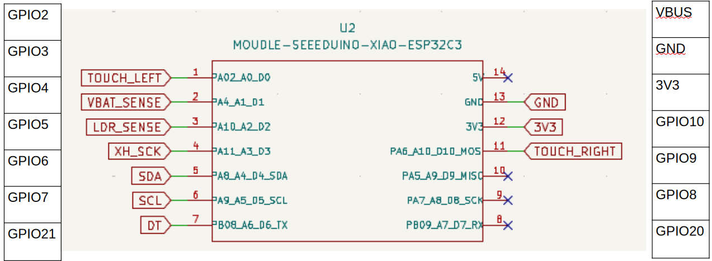

# EspScale

Zephyr-based espresso scale built on the Seeed Studio XIAO ESP32C3.

## Hardware

| Component | Purpose |
|---|---|
| Seeed Studio XIAO ESP32C3 | Microcontroller |
| HX711 + load cell | Weight measurement |
| 2× SparkFun LED display (HT16K33, I²C) | Display |
| 2× TTP223 touch button | User input |
| LDR | Automatic display brightness |



## Requirements

- Zephyr 4.4.0-rc1 (switch to the final `v4.4.0` tag once it is released)
- Zephyr SDK and `west`

## Build and Flash

```bash
west build -p always -b xiao_esp32c3
west flash
```

## License

MIT, see [LICENSE](LICENSE).