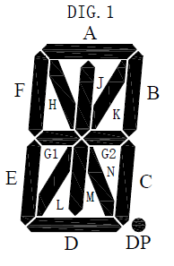

# 14-Segment Display Mapping (VK16K33)

## Segment Layout

```
     A-----
 F| H\ J| K/ B|
     G1-- G2--
 E| L/ M| N\ \C
     D-----
```



---

## RAM Mapping

| Address | Bit 7 | Bit 6 | Bit 5 | Bit 4 | Bit 3 | Bit 2 | Bit 1 | Bit 0 |
|--------|------|------|------|------|------|------|------|------|
| 0  | G23 | G22 | G21 | I0 | A3 | A2 | A1 | A0 |
| 1  | | | | | | | | Colon (0x01 = on, 0x00 = off) |
| 2  | H3 | H2 | H1 | N0 | B3 | B2 | B1 | B0 |
| 3  | | | | | | | | Decimal Point (0x01 = on, 0x00 = off) |
| 4  | J3 | J2 | J1 | G0 | C3 | C2 | C1 | C0 |
| 5  | | | | | | | | unused |
| 6  | K3 | K2 | K1 | H0 | D3 | D2 | D1 | D0 |
| 7  | | | | | | | | unused |
| 8  | N3 | N2 | N1 | J0 | E3 | E2 | E1 | E0 |
| 9  | | | | | | | | unused |
| 10 | M3 | M2 | M1 | K0 | F3 | F2 | F1 | F0 |
| 11 | | | | | | | | unused |
| 12 | L3 | L2 | L1 | L0 | G13 | 12 | G11 | G10 |
| 13 | | | | | | | | unused |
| 14 | | | | | | | | unused |
| 15 | | | | | | | | unused |

---

## Bit-Bedeutung

- Bit 0–3 → Digit 0–3
- Beispiel:
  - A0 = Segment A, Digit 0
  - A1 = Segment A, Digit 1

---

## Character Definition

### Beispiel: "A" auf Digit 0

Aktive Segmente:
A, B, C, E, F, G1, G2

### RAM-Zugriffe

| Segment | Adresse | Bit |
|---------|--------|-----|
| A  | 0  | 0 |
| B  | 2  | 0 |
| C  | 4  | 0 |
| E  | 8  | 0 |
| F  | 10 | 0 |
| G1 | 12 | 0 |
| G2 | 0  | 4 |

Als Liste:

```
{0,0 + offset}, {2,0 + offset}, {4,0 + offset}, {8,0 + offset}, {10,0 + offset}, {12,0 + offset}, {0,4 + offset}
```
